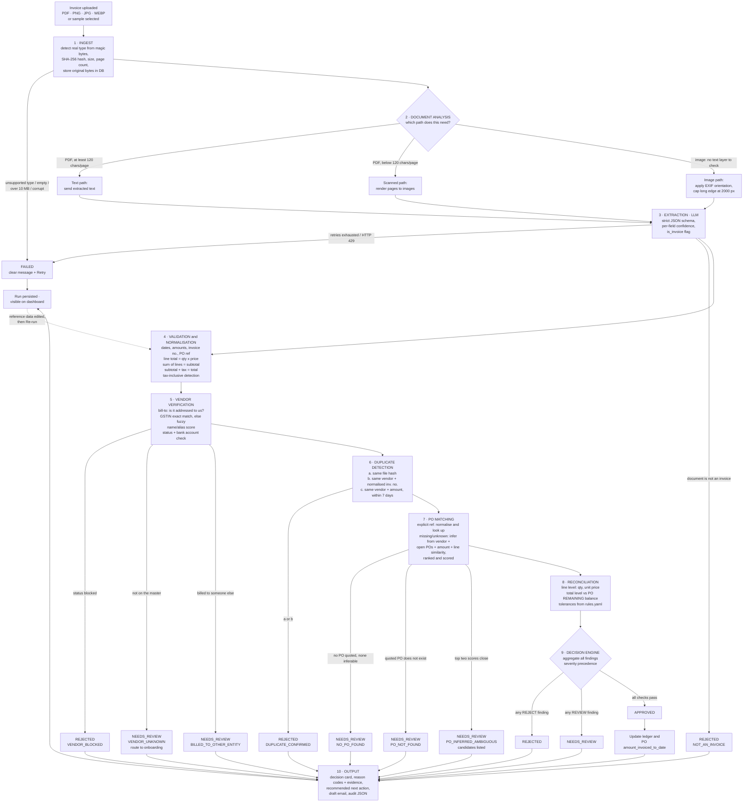

# Process Map — AI Invoice Processing Pipeline

**Company:** Acme Manufacturing Pvt Ltd (fictional, India) · **Currency:** INR · **Tax:** GST
**Matching model:** 2-way match (Invoice ↔ Purchase Order)

---

## 1. Design principle

> **The LLM reads. Deterministic code decides.**

| Concern | Owner | Why |
|---|---|---|
| Reading a messy PDF into structured fields | Gemini (vision/text), schema-constrained, `temperature=0` | Layout variation and scans are a perception problem; no rule can parse every vendor template. |
| Deciding APPROVE / REVIEW / REJECT | Pure-Python rules engine, no LLM calls | Auditability, reproducibility, and control of financial risk. Same input + same reference data ⇒ same decision, every time. |
| Phrasing the decision in plain English | Deterministic templates filled with reason codes + evidence | No second LLM call (free-tier budget), and the words can never drift from the decision. |

Exactly **one LLM call per run** (extraction). Everything downstream is deterministic and unit-testable without network access.

---

## 2. End-to-end flow

**An unknown vendor does not stop the pipeline.** Stages 6 to 8 still run and
still report — duplicate detection, PO matching and reconciliation each say
what they found, or why they could not look — so a reviewer sees the whole
picture rather than only the first thing that was wrong. `VENDOR_UNKNOWN` is
simply shown as the **primary** reason, because who is being paid has to be
settled before anything about the amount matters.

The dotted edge back into stage 4 is the **Re-run** button. Adding a vendor or
a PO on the Reference Data page and re-running decides the same document again
against the reference data as it now stands. The stored model response is
replayed rather than the document re-read, so a re-run spends no quota and the
only thing that can have changed is the reference data — which is the whole
point of pressing it. The superseded run's ledger entry is withdrawn first;
without that, the document would match itself as a duplicate.

### Input types

| Input | How it is identified | Path taken | Code recorded |
|---|---|---|---|
| **Text PDF** | `%PDF-` header, ≥ 120 extractable chars/page | Extracted text is sent to the model | — |
| **Scanned PDF** | `%PDF-` header, < 120 chars/page | Pages rendered to PNG and sent as images | `SCANNED_DOCUMENT` |
| **Image** (PNG, JPG/JPEG, WEBP) | Image magic bytes | Straight to vision — there is no text layer to test | `IMAGE_UPLOAD` |
| Anything else | Magic bytes name it (GIF, ZIP/Office, TIFF, text…) | Refused | `FILE_TYPE_UNSUPPORTED` |

The type is read from the file's **content**, never its extension: a `.txt`
renamed `.png` fails as the text file it is, and a PDF renamed `.png` is
processed as the PDF it is.

**What happens to an image before the model sees it.** EXIF orientation is
applied first — a phone stores the sensor's view plus a tag saying which way
is up, and a model handed the raw pixels would be reading a sideways invoice.
The long edge is then capped at 2000 px, because beyond that nothing more
becomes legible and every extra pixel is free-tier tokens. Both the original
and the processed dimensions are shown on the stage, so what was sent is
never in doubt. If the shorter side of the uploaded image is under 600 px,
`LOW_IMAGE_QUALITY` holds the invoice for a human rather than trusting an
extraction nobody can verify. The **original** bytes are what get stored,
hashed for duplicate detection, and shown in the preview panel.

Every stage streams `pending → running → passed | warning | failed | skipped` over **Server-Sent Events**, and is persisted as a `RunStep` row with start/end time, duration, a one-line human summary and a structured detail payload.

---

## 3. Decision outcomes

| Outcome | Meaning | Side effects |
|---|---|---|
| **APPROVED** | All checks passed, or only within-tolerance variances. Ready for payment. | Ledger entry written; PO `amount_invoiced_to_date` incremented. |
| **NEEDS_REVIEW** | A human must look. Output states *exactly what* and *why*, with evidence numbers and a suggested next action. | Ledger entry written as `held`; PO balance **not** moved. |
| **REJECTED** | Clear policy violation. | Ledger entry written as `rejected`; PO balance not moved. |
| **FAILED** | The system could not process the input (corrupt file, provider down after retries). Shown honestly, with a Retry button. | Nothing written to ledger. |

### Severity precedence

`REJECT > REVIEW > APPROVE`

The engine collects **all** findings from every stage — it never short-circuits, because a reviewer should see everything that was wrong, not just the first thing. The outcome is the highest severity present. Reason codes are then sorted by severity and by their declaration order in the table below, so the "top reason" shown on the dashboard is always the most consequential one, and the decision card lists **every** finding in that same order, each with the evidence that produced it. The first is badged **Primary** — with four or five findings on one invoice, which of them drove the outcome is not otherwise obvious.

Within `NEEDS_REVIEW`, the two counterparty codes — `VENDOR_UNKNOWN` and `BILLED_TO_OTHER_ENTITY` — are declared first on purpose. Until it is settled who is being paid, and that the invoice is addressed to us at all, no amount-level finding is the most useful thing to put in front of a reviewer.

---

## 4. Tolerance policy (`config/rules.yaml`)

| Rule | Threshold | Rationale |
|---|---|---|
| Invoice total vs expected amount | within **±2% or ±₹500, whichever is smaller** | Absorbs rounding and small freight differences without absorbing real price creep. The "whichever is smaller" guard stops the percentage band from becoming large on big invoices. |
| Line-item unit price variance | **> 5%** above PO price → hold | A per-line check catches a single inflated SKU that a total-level check would hide. |
| Line-item quantity variance | **> 2%** above PO qty → hold | Over-delivery needs procurement sign-off. |
| Cumulative billing against a PO | must not exceed `total_amount` + tolerance | Supports legitimate split invoicing while blocking over-billing. |
| Suspected-duplicate window | same vendor + same total within **7 days** | Catches re-sends issued under a fresh invoice number. |
| Minimum field confidence | **0.70** on critical fields | Below this, route to a human rather than guess. |
| Vendor fuzzy-name match | **≥ 0.88** auto-accept · **0.70–0.88** review · **< 0.70** no match | Name variants ("Bharat Steel Ind.") must match; unrelated vendors must not. |
| PO inference | top score **≥ 0.75** and ahead of the runner-up by **≥ 0.15** | A confident single candidate proceeds and says it was inferred; anything closer is ambiguous → review. |

All thresholds are read from one YAML file at runtime and displayed on the Reference Data page, so they are visibly policy, not code.

---

## 5. Reason code reference

Every code carries a `severity`, a human-readable message template, and the **evidence** — the actual numbers that were compared.

### REJECT

| Code | Fires when | Evidence shown |
|---|---|---|
| `NOT_AN_INVOICE` | Model flags the document as a quote / receipt / credit note / other | Detected document type |
| `DUPLICATE_CONFIRMED_HASH` | Byte-identical file already processed | Original run id, date, outcome |
| `DUPLICATE_CONFIRMED_NUMBER` | Same vendor + same normalised invoice number in ledger | Both raw numbers, the normalised form, original date and amount |
| `VENDOR_BLOCKED` | Vendor **is** on the master, with status `blocked` | Vendor id, status |
| `PO_CLOSED` | Referenced PO has status `closed` | PO number, status, amount already invoiced |

### NEEDS_REVIEW

| Code | Fires when | Evidence shown |
|---|---|---|
| `VENDOR_UNKNOWN` | No vendor on the master matches by GSTIN, and no name scores ≥ 0.70 | Invoice vendor name and GSTIN, best candidate and its score, the threshold — plus the invoice number, date and amount the onboarding email is written from |
| `BILLED_TO_OTHER_ENTITY` | The "Bill To / Buyer" is neither our GSTIN nor our name above 0.70 | Buyer name and GSTIN as read, our name and GSTIN, the similarity score |
| `PO_OVERBILLED` | Invoice total exceeds PO remaining balance + tolerance | PO total, invoiced to date, remaining, invoice total, overage |
| `PRICE_VARIANCE_EXCEEDS_TOLERANCE` | A line's unit price exceeds the PO price by more than 5% | Per line: description, PO price, invoice price, % variance |
| `QTY_VARIANCE_EXCEEDS_TOLERANCE` | A line's quantity exceeds PO quantity by more than 2% | Per line: PO qty, invoice qty, difference |
| `TOTAL_VARIANCE_EXCEEDS_TOLERANCE` | Total falls outside the ±2% / ±₹500 band | Expected, actual, difference, band applied |
| `VENDOR_BANK_MISMATCH` | Bank account on the invoice differs from vendor master | Last 4 on invoice vs last 4 on master |
| `VENDOR_PENDING` | Vendor is on the master but onboarding is incomplete (`pending`) | Vendor id, status |
| `VENDOR_FUZZY_MATCH_LOW` | Name match score between 0.70 and 0.88 | Invoice name, matched name, score |
| `GSTIN_MISMATCH` | GSTIN on invoice differs from master GSTIN for the matched vendor | Both GSTINs |
| `GSTIN_INVALID_FORMAT` | GSTIN fails the 15-character format/checksum test | The GSTIN as read |
| `DUPLICATE_SUSPECTED` | Same vendor + same total within 7 days, different number | Both invoice numbers, dates, amount |
| `NO_PO_FOUND` | No PO is quoted and none could be inferred — including when the vendor is unknown, so there are no POs to search | Where the search looked, and the invoice total |
| `PO_NOT_FOUND` | A reference *was* printed but matched no PO, and inference found nothing | PO ref as written and normalised |
| `PO_INFERRED_AMBIGUOUS` | Two or more inference candidates score close together | Each candidate with its score and score components |
| `PO_INFERRED_LOW_CONFIDENCE` | Best inference candidate scores below 0.75 | Candidate, score, components |
| `PO_VENDOR_MISMATCH` | The PO belongs to a different vendor than the invoice | PO vendor, invoice vendor |
| `LINE_NOT_ON_PO` | An invoiced line has no counterpart on the PO | Line description, amount |
| `MISSING_INVOICE_NUMBER` | Critical field absent from the document | — |
| `MISSING_INVOICE_DATE` | Critical field absent from the document | — |
| `MISSING_TOTAL` | Critical field absent from the document | — |
| `LOW_CONFIDENCE_CRITICAL_FIELD` | Model confidence below 0.70 on a critical field | Field name, confidence |
| `LOW_IMAGE_QUALITY` | An uploaded image's shorter side is under 600 px | Uploaded dimensions, the threshold |
| `ARITHMETIC_LINES_VS_SUBTOTAL` | Sum of line amounts ≠ stated subtotal (beyond ₹1 rounding) | Sum of lines, stated subtotal, difference |
| `ARITHMETIC_SUBTOTAL_TAX_TOTAL` | subtotal + tax ≠ total (beyond ₹1 rounding) | Each component and the gap |
| `CURRENCY_MISMATCH` | Invoice currency differs from PO currency | Both currencies |

### INFO — recorded and shown, never blocks

| Code | Fires when |
|---|---|
| `TOTAL_VARIANCE_WITHIN_TOLERANCE` | Total differs from expected but sits inside the band |
| `PO_INFERRED_HIGH_CONFIDENCE` | The PO was inferred rather than quoted — stated explicitly on the decision card |
| `PARTIAL_INVOICE_AGAINST_PO` | The invoice bills part of an open PO; remaining balance is shown |
| `TAX_INCLUSIVE_PRESENTATION` | Prices are presented inclusive of GST; normalised before comparison |
| `PO_HAS_NO_LINE_DETAIL` | The matched PO holds a committed value with no line items (a blanket or service PO), so only the total could be reconciled |
| `SCANNED_DOCUMENT` | A PDF had no text layer; its pages were rendered and read as images |
| `IMAGE_UPLOAD` | The invoice arrived as an image (photo or screenshot) and went straight to the vision path |

### FAILED

| Code | Fires when |
|---|---|
| `FILE_TYPE_UNSUPPORTED` | The file is not a PDF, PNG, JPG or WEBP — the message names what it actually is and lists what would be accepted |
| `FILE_TOO_LARGE` | The file is over the 10 MB limit in `rules.yaml` |
| `FILE_EMPTY` / `FILE_CORRUPT` / `FILE_ENCRYPTED` | Ingest cannot open the input |
| `FILE_IMAGE_UNREADABLE` | The bytes claim to be an image but cannot be decoded |
| `LLM_RATE_LIMITED` | HTTP 429 persists after retries and the fallback model |
| `LLM_UNAVAILABLE` | Provider error or timeout after retries |
| `EXTRACTION_SCHEMA_INVALID` | Model output fails schema validation after retries |

---

## 6. Scenario → expected outcome

| # | Scenario | Expected outcome | Key reason codes |
|---|---|---|---|
| 0 | Happy path — clean text PDF, approved vendor, explicit PO, amounts match | `APPROVED` | — (all checks pass) |
| 1 | Scanned image-only PDF, no PO reference | `APPROVED` | `SCANNED_DOCUMENT`, `PO_INFERRED_HIGH_CONFIDENCE` |
| 1b | Same, but two similar open POs exist | `NEEDS_REVIEW` | `PO_INFERRED_AMBIGUOUS` |
| 2 | Split PO — third invoice exceeds the remaining balance | #1, #2 `APPROVED`; #3 `NEEDS_REVIEW` | `PARTIAL_INVOICE_AGAINST_PO`, then `PO_OVERBILLED` |
| 3 | Disguised duplicate — `INV/2026/42` vs `INV-2026-0042` | `REJECTED` | `DUPLICATE_CONFIRMED_NUMBER` |
| 3b | Different number, same amount, within 7 days | `NEEDS_REVIEW` | `DUPLICATE_SUSPECTED` |
| 4a | Total off by ₹180 from freight/rounding | `APPROVED` | `TOTAL_VARIANCE_WITHIN_TOLERANCE` |
| 4b | One line's unit price raised 8% against the PO | `NEEDS_REVIEW` | `PRICE_VARIANCE_EXCEEDS_TOLERANCE` |

| 10 | Phone photo of an invoice (JPG, on a desk, at an angle, lit unevenly) matching an open PO exactly | `APPROVED` | `IMAGE_UPLOAD` |
| 9 | Unknown supplier, correctly billed to us, no PO quoted | `NEEDS_REVIEW`, then `APPROVED` after onboarding + a PO | `VENDOR_UNKNOWN` (primary), `NO_PO_FOUND`; then `PO_INFERRED_HIGH_CONFIDENCE` |
| — | Consumer receipt — unknown seller, billed to an individual | `NEEDS_REVIEW` | `VENDOR_UNKNOWN` (primary), `BILLED_TO_OTHER_ENTITY`, `NO_PO_FOUND` |

Additional cases that must be handled without crashing (not featured in the video): an unsupported file type, an oversized file, encrypted or corrupt PDF, a quotation instead of an invoice, a blocked vendor, a bank-detail mismatch, and an LLM timeout.
